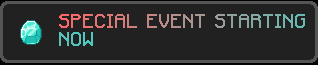

# CoreviaAchievement

**[Turkce](README_TR.md)** | English


Advanced achievement notification system for Minecraft servers with full customization support, gradient colors, and modern Minecraft advancement API integration.

---

## 📸 Screenshots

<p align="center">
  
  
</p>
<p align="center">
  
  
</p>
<p align="center">
  
</p>

### Screenshot Descriptions:
- **Gradient Effect**: Beautiful color transitions from red to blue
- **Mixed Formatting**: Bold text with gradient colors and special formatting
- **Emoji Integration**: Emoji icons combined with gradient text effects
- **Goal Reached**: Standard yellow-bordered goal frame for achievements
- **Challenge Frame**: Purple-bordered challenge frame for special announcements

---

## Table of Contents

- [Features](#features)
- [Compatibility](#compatibility)
- [Installation](#installation)
- [Commands](#commands)
- [Permissions](#permissions)
- [Configuration](#configuration)
- [Usage Examples](#usage-examples)
- [Color Formatting Guide](#color-formatting-guide)
- [API for Developers](#api-for-developers)
- [Building from Source](#building-from-source)
- [Troubleshooting](#troubleshooting)
- [Contributing](#contributing)
- [License](#license)
- [Support](#support)

---

## Features

### Core Features
- **Custom Achievement Notifications** - Send beautiful achievement messages to all players
- **Modern Advancement API** - Uses Minecraft's native advancement system for authentic notifications
- **Full Color Support** - Legacy color codes, hex colors, and gradient effects
- **Customizable Icons** - Choose any Minecraft material as the achievement icon
- **Frame Types** - GOAL, TASK, or CHALLENGE frames for different notification styles
- **Sound Effects** - Configurable sound notifications with volume and pitch control
- **Hot-Reload** - Reload configuration without restarting the server
- **Permission System** - Flexible permission-based command access
- **Animation Control** - Adjustable notification display duration
- **Resource Pack Support** - Custom model data support for resource pack items

### Advanced Features
- **Gradient Color System** - Smooth color transitions with `<g:#COLOR1:#COLOR2>` syntax
- **Color Mixing** - Combine legacy codes with hex and gradient colors
- **Debug Mode** - Detailed logging for troubleshooting
- **Packet Method Options** - Automatic, reflection, or direct API packet sending
- **Legacy Compatibility** - Fallback support for older server versions
- **UTF-8 Support** - Full Unicode character support in messages
- **Prefix/Suffix System** - Add custom prefix and suffix to all messages

---

## Compatibility

### Minecraft Versions
- **1.16.x** - Full support
- **1.17.x** - Full support
- **1.18.x** - Full support
- **1.19.x** - Full support
- **1.20.x** - Full support
- **1.21.x** - Full support (tested up to 1.21.9)

### Server Software
- Spigot 1.16+
- Paper 1.16+
- Purpur 1.16+
- Folia (and Folia forks such as CanvasMC)
- Any Spigot-based fork

### Folia
The plugin declares `folia-supported: true`. On Folia the temporary advancement is loaded and unloaded on the global region thread, while granting, revoking and the sound run on each player's own entity scheduler. On Spigot and Paper the same code falls back to the regular Bukkit scheduler.

### Java Version
- Java 17 or higher (recommended)

---

## Installation

### Standard Installation

1. Download the latest `CoreviaAchievement-X.X.X.jar` from the [Releases](../../releases) page
2. Place the JAR file in your server's `plugins` folder
3. Restart your server or use a plugin manager to load it
4. Configuration files will be automatically generated in `plugins/CoreviaAchievement/`
5. Edit `config.yml` to customize the plugin (optional)
6. Use `/achievement reload` to apply configuration changes

### First Time Setup

After installation, the plugin is ready to use with default settings. No additional configuration is required.

**Default Settings:**
- Icon: Diamond
- Frame: GOAL (yellow)
- Sound: Achievement complete sound
- Animation: 5 seconds
- All features enabled

---

## Commands

### Main Command
```
/achievement <send|reload> [message]
```

**Aliases:** `/ach`, `/adv`

### Sub-Commands

| Command | Description | Permission | Usage |
|---------|-------------|------------|-------|
| `/achievement send <message>` | Send achievement notification to all online players | `achievement.send` | `/ach send Welcome to the server!` |
| `/achievement reload` | Reload configuration from `config.yml` | `achievement.reload` | `/ach reload` |

---

## Permissions

| Permission | Description | Default |
|------------|-------------|---------|
| `achievement.*` | Access to all achievement commands | op |
| `achievement.send` | Allows sending achievement messages | op |
| `achievement.reload` | Allows reloading configuration | op |

### Permission Setup Examples

**Give all permissions:**
```yaml
permissions:
  - achievement.*
```

**Give only send permission:**
```yaml
permissions:
  - achievement.send
```

---

## Configuration

The plugin generates a detailed `config.yml` file with all available options. Below are the main configuration sections:

### General Settings
```yaml
settings:
  enabled: true        # Enable/disable the plugin
  debug: false         # Enable debug logging
```

### Achievement Appearance
```yaml
achievement:
  icon:
    material: "DIAMOND"           # Icon material
    custom-model-data: 0          # Custom model data for resource packs
  
  frame:
    type: "GOAL"                  # GOAL, TASK, or CHALLENGE
  
  title:
    prefix: ""                    # Message prefix
    suffix: ""                    # Message suffix
  
  animation:
    enabled: true                 # Enable animation
    duration: 5                   # Duration in seconds (1-10)
```

### Sound Settings
```yaml
advanced:
  sound:
    enabled: true
    type: "UI_TOAST_CHALLENGE_COMPLETE"
    volume: 1.0
    pitch: 1.0
```

### Color Format Settings
```yaml
advanced:
  format:
    strip-colors: false           # Remove all colors
    allow-legacy-colors: true     # Enable & color codes
    allow-hex-colors: true        # Enable hex colors
```

### Frame Types Explained

| Frame Type | Appearance | Use Case |
|------------|------------|----------|
| **GOAL** | Yellow border, rounded | Standard achievements, general announcements |
| **TASK** | White border, simple | Simple tasks, basic notifications |
| **CHALLENGE** | Purple border, fancy | Special events, rare achievements |

---

## Usage Examples

### Basic Messages
```
/achievement send Welcome to our server!
/achievement send Server restart in 5 minutes
/achievement send Thank you for playing with us
```

### Legacy Color Codes
```
/achievement send &cRed text &aGreen text
/achievement send &l&6Bold golden announcement
/achievement send &n&bUnderlined cyan message
```

### Hex Colors (1.16+)
```
/achievement send #FF5733This is orange text
/achievement send #00FFFFCyan colored message
/achievement send #FFD700Golden announcement
```

### Gradient Effects
```
/achievement send <g:#FF0000:#0000FF>Red to Blue gradient</g>
/achievement send <gradient:#FFD700:#FF1493>Gold to Pink</gradient>
/achievement send <g:#00FF00:#FFFF00:#FF0000>Multi-color gradient</g>
```

### Combined Formatting
```
/achievement send &l<g:#FF6B6B:#4ECDC4>SPECIAL EVENT STARTING NOW</g>
/achievement send <g:#00FF00:#FFFF00>Player123</g> &rwon the lottery!
/achievement send &6[&cAlert&6] <g:#FF0000:#FFA500>Server maintenance in 10 minutes</g>
```

---

## Color Formatting Guide

### Legacy Color Codes

| Code | Color | Code | Format |
|------|-------|------|--------|
| `&0` | Black | `&l` | Bold |
| `&1` | Dark Blue | `&m` | Strikethrough |
| `&2` | Dark Green | `&n` | Underline |
| `&3` | Dark Aqua | `&o` | Italic |
| `&4` | Dark Red | `&r` | Reset |
| `&5` | Dark Purple | | |
| `&6` | Gold | | |
| `&7` | Gray | | |
| `&8` | Dark Gray | | |
| `&9` | Blue | | |
| `&a` | Green | | |
| `&b` | Aqua | | |
| `&c` | Red | | |
| `&d` | Light Purple | | |
| `&e` | Yellow | | |
| `&f` | White | | |

### Hex Color Format
```
#RRGGBBText here
```
Example: `#FF5733Beautiful orange color`

### Gradient Format
```
<g:#START_COLOR:#END_COLOR>Text here</g>
```
or
```
<gradient:#START_COLOR:#END_COLOR>Text here</gradient>
```

Example: `<g:#FF0000:#0000FF>Red to Blue</g>`

### Multi-Color Gradients
```
<g:#COLOR1:#COLOR2:#COLOR3>Text</g>
```

Example: `<g:#FF0000:#00FF00:#0000FF>Rainbow</g>`

---

## API for Developers

### Adding it to your project
The plugin isn't published to a Maven repository yet. Build it (or grab the jar from [Releases](../../releases)) and add it as a compile-only dependency:

```gradle
dependencies {
    compileOnly files('libs/CoreviaAchievement-1.1.0.jar')
}
```

Add `depend: [CoreviaAchievement]` or `softdepend` to your own `plugin.yml`.

### Getting the Plugin Instance
```java
import dev.husecik.achievement.CoreviaAchievement;

CoreviaAchievement plugin = CoreviaAchievement.getInstance();
```

### Sending Achievement Messages
```java
import dev.husecik.achievement.CoreviaAchievement;
import dev.husecik.achievement.util.AchievementSender;
import org.bukkit.entity.Player;

// Get the achievement sender
AchievementSender sender = CoreviaAchievement.getInstance().getAchievementSender();

// Send to a specific player (safe to call from any thread, including on Folia)
Player player = ...; // Get player
sender.sendAchievement(player, "Your custom message");

// Send to all players
for (Player p : Bukkit.getOnlinePlayers()) {
    sender.sendAchievement(p, "Broadcast message");
}
```

### Configuration Access
```java
import dev.husecik.achievement.config.ConfigManager;

ConfigManager config = CoreviaAchievement.getInstance().getConfigManager();

// Get config values
boolean enabled = config.isEnabled();
String material = config.getIconMaterial();
String frameType = config.getFrameType();
int duration = config.getAnimationDuration();

// Reload configuration
CoreviaAchievement.getInstance().reload();
```

### Custom Achievement with All Options
```java
// The plugin automatically handles:
// - Color formatting (legacy, hex, gradients)
// - Icon display
// - Sound effects
// - Animation duration
// All based on your config.yml settings

sender.sendAchievement(player, "<g:#FFD700:#FF1493>Congratulations!</g>");
```

---

## Building from Source

### Prerequisites
- Java Development Kit (JDK) 17 or higher
- Nothing else: the Gradle wrapper (Gradle 9) is included

### Build Steps

1. Clone the repository:
```bash
git clone https://github.com/esermedias/CoreviaAchievement.git
cd CoreviaAchievement
```

2. Build the project:
```bash
# Windows
gradlew.bat build

# Linux/Mac
./gradlew build
```

3. The compiled JAR will be located at:
```
build/libs/CoreviaAchievement-1.1.0.jar
```

### Development Setup

1. Import the project into your IDE (IntelliJ IDEA recommended)
2. Ensure JDK 17 is configured
3. Gradle dependencies will be automatically downloaded
4. Build configuration is in `build.gradle`

---

## Troubleshooting

### Common Issues

#### Achievement not showing
**Problem:** Players don't see the achievement notification

**Solutions:**
1. Check if plugin is enabled in `config.yml`: `settings.enabled: true`
2. Verify Minecraft version compatibility (1.16+)
3. Enable debug mode and check console logs
4. Try changing packet method to `REFLECTION` in config
5. Ensure players have advancement notifications enabled in their client

#### Colors not working
**Problem:** Color codes appear as plain text

**Solutions:**
1. For hex colors, ensure Minecraft 1.16+
2. Check `allow-legacy-colors: true` in config
3. Check `allow-hex-colors: true` in config
4. Verify `strip-colors: false` in config
5. Test with simple legacy codes first: `&cTest`

#### Sound not playing
**Problem:** Achievement appears but no sound

**Solutions:**
1. Check `sound.enabled: true` in config
2. Verify sound name is valid for your Minecraft version
3. Ensure players have master volume enabled
4. Test with default sound: `UI_TOAST_CHALLENGE_COMPLETE`

#### Configuration not loading
**Problem:** Changes to config.yml don't apply

**Solutions:**
1. Use `/achievement reload` after editing config
2. Check YAML syntax (spaces, not tabs)
3. Ensure file encoding is UTF-8
4. Check console for error messages
5. Delete config.yml and let plugin regenerate

#### Permission denied
**Problem:** Operators can't use commands

**Solutions:**
1. Verify you're an operator: `/op yourname`
2. Check permissions in your permission plugin
3. Use `*` or `achievement.*` permission
4. Restart server after permission changes

### Debug Mode

Enable debug mode for detailed information:
```yaml
settings:
  debug: true
```

Then check console logs after using commands.

### Getting Help

If you can't solve the issue:
1. Enable debug mode
2. Reproduce the issue
3. Check console logs
4. Contact support with logs and config file

---

## Contributing

Contributions are welcome! Here's how you can help:

### Reporting Bugs
1. Check existing issues first
2. Use the bug report template
3. Include:
   - Minecraft version
   - Server software and version
   - Plugin version
   - Steps to reproduce
   - Error logs (if any)

### Suggesting Features
1. Open an issue with the feature request template
2. Describe the feature in detail
3. Explain the use case

### Pull Requests
1. Fork the repository
2. Create a feature branch: `git checkout -b feature/amazing-feature`
3. Commit your changes: `git commit -m 'Add amazing feature'`
4. Push to the branch: `git push origin feature/amazing-feature`
5. Open a Pull Request

### Code Style
- Follow Java naming conventions
- Use meaningful variable and method names
- Add JavaDoc comments for public methods
- Maintain existing code structure
- Test your changes thoroughly

---

## License

This project is licensed under the MIT License - see the [LICENSE](LICENSE) file for details.

### Third-Party Libraries

- **Paper API** - GPL v3 (compile-only, not bundled)

---

## Support

### Contact Information

- **Developer:** husecik
- **Website:** [https://coreviabilisim.net](https://coreviabilisim.net)
- **GitHub Issues:** [Report a bug or request a feature](../../issues)

### Server Compatibility

If you encounter compatibility issues with specific server versions or forks, please report them with:
- Server software name and version
- Minecraft protocol version
- Any error messages from console

---

## Acknowledgments

Special thanks to:
- The Spigot/Paper development team for excellent server software
- The Minecraft community for feedback and testing
- All contributors who helped improve this plugin

---

## Changelog

### Version 1.1.0
- Folia support (`folia-supported: true`), with a scheduler layer that also works on Spigot and Paper
- New `AchievementSender#sendAchievement(Player, String)` for sending to a single player
- Gradients now accept more than two color stops
- Build moved to Gradle 9 and the Paper API, with a working Gradle wrapper
- GitHub Actions build on every push

### Version 1.0.0
- Initial release
- Achievement notification system
- Full color support (legacy, hex, gradients)
- Configurable icons and frames
- Sound effects
- Permission system
- Hot-reload configuration
- API for developers

---

**Made with dedication for the Minecraft community**

Star this repository if you find it useful!
