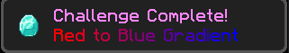
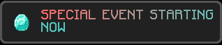
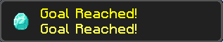
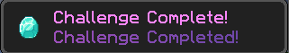

# CoreviaAchievement

Turkce | **[English](README.md)**


Gelismis ozellestime destegi, gradyan renkler ve modern Minecraft advancement API entegrasyonu ile Minecraft sunuculari icin gelismis basari bildirimi sistemi.

---

## 📸 Ekran Görüntüleri

<p align="center">
  
  
</p>
<p align="center">
  
  
</p>
<p align="center">
  
</p>

### Ekran Görüntüsü Açıklamaları:
- **Gradyan Efekti**: Kırmızıdan maviye güzel renk geçişleri
- **Karışık Formatlama**: Kalın yazı ile gradyan renkler ve özel formatlama
- **Emoji Entegrasyonu**: Emoji ikonları gradyan metin efektleri ile birleştirilmiş
- **Hedef Ulaşıldı**: Başarılar için standart sarı kenarlıklı goal cercevesi
- **Challenge Cercevesi**: Özel duyurular için mor kenarlıklı challenge cercevesi

---

## Icindekiler

- [Ozellikler](#ozellikler)
- [Uyumluluk](#uyumluluk)
- [Kurulum](#kurulum)
- [Komutlar](#komutlar)
- [Izinler](#izinler)
- [Yapilandirma](#yapilandirma)
- [Kullanim Ornekleri](#kullanim-ornekleri)
- [Renk Formatlama Rehberi](#renk-formatlama-rehberi)
- [Geliştiriciler Icin API](#geliştiriciler-icin-api)
- [Kaynak Koddan Derleme](#kaynak-koddan-derleme)
- [Sorun Giderme](#sorun-giderme)
- [Katki Saglama](#katki-saglama)
- [Lisans](#lisans)
- [Destek](#destek)

---

## Ozellikler

### Temel Ozellikler
- **Ozel Basari Bildirimleri** - Tum oyunculara guzel basari mesajlari gonderin
- **Modern Advancement API** - Otantik bildirimler icin Minecraft'in yerel advancement sistemini kullanir
- **Tam Renk Destegi** - Eski renk kodlari, hex renkler ve gradyan efektleri
- **Ozellestirebilir Ikonlar** - Basari ikonu olarak herhangi bir Minecraft materyali secin
- **Cerceve Tipleri** - Farkli bildirim stilleri icin GOAL, TASK veya CHALLENGE cereveleri
- **Ses Efektleri** - Ses seviyesi ve ton kontrolu ile yapilandirilebilir ses bildirimleri
- **Aninda Yeniden Yukleme** - Sunucuyu yeniden baslatmadan yapilandirmayi yeniden yukleyin
- **Izin Sistemi** - Esnek izin tabanli komut erisimi
- **Animasyon Kontrolu** - Ayarlanabilir bildirim gosterim suresi
- **Kaynak Paketi Destegi** - Kaynak paketi itemleri icin ozel model data destegi

### Gelismis Ozellikler
- **Gradyan Renk Sistemi** - `<g:#RENK1:#RENK2>` sozdizimi ile yumusak renk geçisleri
- **Renk Karistirma** - Eski kodlari hex ve gradyan renkleriyle birlestirin
- **Hata Ayiklama Modu** - Sorun giderme icin detayli gunluk kaydi
- **Paket Metodu Secenekleri** - Otomatik, reflection veya dogrudan API paket gonderimi
- **Eski Surum Uyumlulugu** - Eski sunucu surumlerı icin yedek destek
- **UTF-8 Destegi** - Mesajlarda tam Unicode karakter destegi
- **Onek/Sonek Sistemi** - Tum mesajlara ozel onek ve sonek ekleyin

---

## Uyumluluk

### Minecraft Surumlerı
- **1.16.x** - Tam destek
- **1.17.x** - Tam destek
- **1.18.x** - Tam destek
- **1.19.x** - Tam destek
- **1.20.x** - Tam destek
- **1.21.x** - Tam destek (1.21.9'a kadar test edildi)

### Sunucu Yazilimlari
- Spigot 1.16+
- Paper 1.16+
- Purpur 1.16+
- Folia (ve CanvasMC gibi Folia forklari)
- Herhangi bir Spigot tabanli fork

### Java Surumu
- Java 17 veya ustu (onerilir)

---

## Kurulum

### Standart Kurulum

1. [Releases](../../releases) sayfasindan en son `CoreviaAchievement-X.X.X.jar` dosyasini indirin
2. JAR dosyasini sunucunuzun `plugins` klasorune yerlestirin
3. Sunucunuzu yeniden baslatın veya yuklemek icin bir plugin yoneticisi kullanin
4. Yapilandirma dosyalari otomatik olarak `plugins/CoreviaAchievement/` klasorunde olusturulacaktir
5. Plugini ozellestirrnek icin `config.yml` dosyasini duzenleyin (opsiyonel)
6. Yapilandirma degisikliklerini uygulamak icin `/achievement reload` komutunu kullanin

### Ilk Kurulum

Kurulumdan sonra, plugin varsayilan ayarlarla kullanima hazirdir. Ek yapilandirma gerekmez.

**Varsayilan Ayarlar:**
- Ikon: Elmas
- Cerceve: GOAL (sari)
- Ses: Basari tamamlama sesi
- Animasyon: 5 saniye
- Tum ozellikler etkin

---

## Komutlar

### Ana Komut
```
/achievement <send|reload> [mesaj]
```

**Kisaltmalar:** `/ach`, `/adv`

### Alt Komutlar

| Komut | Aciklama | Izin | Kullanim |
|-------|----------|------|----------|
| `/achievement send <mesaj>` | Tum cevrimici oyunculara basari bildirimi gonder | `achievement.send` | `/ach send Sunucumuza hos geldiniz!` |
| `/achievement reload` | `config.yml` dosyasindan yapilandirmayi yeniden yukle | `achievement.reload` | `/ach reload` |

---

## Izinler

| Izin | Aciklama | Varsayilan |
|------|----------|------------|
| `achievement.*` | Tum basari komutlarina erişim | op |
| `achievement.send` | Basari mesajlari gondermeye izin verir | op |
| `achievement.reload` | Yapilandirmayi yeniden yuklemeye izin verir | op |

### Izin Ayarlama Ornekleri

**Tum izinleri ver:**
```yaml
permissions:
  - achievement.*
```

**Sadece gonderme iznini ver:**
```yaml
permissions:
  - achievement.send
```

---

## Yapilandirma

Plugin, tum mevcut seceneklerle ayrintili bir `config.yml` dosyasi olusturur. Asagida ana yapilandirma bolumleri bulunmaktadir:

### Genel Ayarlar
```yaml
settings:
  enabled: true        # Plugini etkinlestir/devre disi birak
  debug: false         # Hata ayiklama gunlugunu etkinlestir
```

### Basari Gorunumu
```yaml
achievement:
  icon:
    material: "DIAMOND"           # Ikon materyali
    custom-model-data: 0          # Kaynak paketleri icin ozel model datasi
  
  frame:
    type: "GOAL"                  # GOAL, TASK veya CHALLENGE
  
  title:
    prefix: ""                    # Mesaj oneki
    suffix: ""                    # Mesaj soneki
  
  animation:
    enabled: true                 # Animasyonu etkinlestir
    duration: 5                   # Saniye cinsinden sure (1-10)
```

### Ses Ayarlari
```yaml
advanced:
  sound:
    enabled: true
    type: "UI_TOAST_CHALLENGE_COMPLETE"
    volume: 1.0
    pitch: 1.0
```

### Renk Format Ayarlari
```yaml
advanced:
  format:
    strip-colors: false           # Tum renkleri kaldir
    allow-legacy-colors: true     # & renk kodlarini etkinlestir
    allow-hex-colors: true        # Hex renkleri etkinlestir
```

### Cerceve Tipleri Aciklamasi

| Cerceve Tipi | Gorunum | Kullanim Alani |
|--------------|---------|----------------|
| **GOAL** | Sari cerceve, yuvarlak | Standart basarilar, genel duyurular |
| **TASK** | Beyaz cerceve, basit | Basit gorevler, temel bildirimler |
| **CHALLENGE** | Mor cerceve, suslu | Ozel etkinlikler, nadir basarilar |

---

## Kullanim Ornekleri

### Temel Mesajlar
```
/achievement send Sunucumuza hos geldiniz!
/achievement send Sunucu 5 dakika icinde yeniden baslatilacak
/achievement send Bizimle oynadiginiz icin tesekkurler
```

### Eski Renk Kodlari
```
/achievement send &cKirmizi yazi &aYesil yazi
/achievement send &l&6Kalin altin duyuru
/achievement send &n&bAltı cizili camgobegi mesaj
```

### Hex Renkler (1.16+)
```
/achievement send #FF5733Bu turuncu yazi
/achievement send #00FFFFCamgobegi renkli mesaj
/achievement send #FFD700Altin duyuru
```

### Gradyan Efektleri
```
/achievement send <g:#FF0000:#0000FF>Kirmizidan maviye gecis</g>
/achievement send <gradient:#FFD700:#FF1493>Altindan pembere</gradient>
/achievement send <g:#00FF00:#FFFF00:#FF0000>Cok renkli gradyan</g>
```

### Birlesik Formatlama
```
/achievement send &l<g:#FF6B6B:#4ECDC4>OZEL ETKINLIK SIMDI BASLIYOR</g>
/achievement send <g:#00FF00:#FFFF00>Oyuncu123</g> &rpiyango kazandi!
/achievement send &6[&cUyari&6] <g:#FF0000:#FFA500>10 dakika icinde sunucu bakimi</g>
```

---

## Renk Formatlama Rehberi

### Eski Renk Kodlari

| Kod | Renk | Kod | Format |
|-----|------|-----|--------|
| `&0` | Siyah | `&l` | Kalin |
| `&1` | Koyu Mavi | `&m` | Ustü cizili |
| `&2` | Koyu Yesil | `&n` | Alti cizili |
| `&3` | Koyu Camgobegi | `&o` | Italik |
| `&4` | Koyu Kirmizi | `&r` | Sifirla |
| `&5` | Koyu Mor | | |
| `&6` | Altin | | |
| `&7` | Gri | | |
| `&8` | Koyu Gri | | |
| `&9` | Mavi | | |
| `&a` | Yesil | | |
| `&b` | Camgobegi | | |
| `&c` | Kirmizi | | |
| `&d` | Acik Mor | | |
| `&e` | Sari | | |
| `&f` | Beyaz | | |

### Hex Renk Formati
```
#RRGGBBBuraya yazi
```
Ornek: `#FF5733Guzel turuncu renk`

### Gradyan Formati
```
<g:#BASLANGIC_RENK:#BITIS_RENK>Buraya yazi</g>
```
veya
```
<gradient:#BASLANGIC_RENK:#BITIS_RENK>Buraya yazi</gradient>
```

Ornek: `<g:#FF0000:#0000FF>Kirmizidan maviye</g>`

### Cok Renkli Gradyanlar
```
<g:#RENK1:#RENK2:#RENK3>Yazi</g>
```

Ornek: `<g:#FF0000:#00FF00:#0000FF>Gokkusagi</g>`

---

## Geliştiriciler Icin API

### Projeye ekleme
Eklenti henuz bir Maven deposunda yayinlanmadi. Derleyin (ya da [Releases](../../releases) sayfasindan jar'i indirin) ve compile-only bagimlilik olarak ekleyin:

```gradle
dependencies {
    compileOnly files('libs/CoreviaAchievement-1.1.0.jar')
}
```

Kendi `plugin.yml` dosyaniza `depend: [CoreviaAchievement]` veya `softdepend` ekleyin.

### Plugin Instance'i Alma
```java
import dev.husecik.achievement.CoreviaAchievement;

CoreviaAchievement plugin = CoreviaAchievement.getInstance();
```

### Basari Mesajlari Gonderme
```java
import dev.husecik.achievement.CoreviaAchievement;
import dev.husecik.achievement.util.AchievementSender;
import org.bukkit.entity.Player;

// Achievement sender'i al
AchievementSender sender = CoreviaAchievement.getInstance().getAchievementSender();

// Belirli bir oyuncuya gonder
Player player = ...; // Oyuncuyu al
sender.sendAchievement(player, "Ozel mesajiniz");

// Tum oyunculara gonder
for (Player p : Bukkit.getOnlinePlayers()) {
    sender.sendAchievement(p, "Yayın mesaji");
}
```

### Yapilandirmaya Erişim
```java
import dev.husecik.achievement.config.ConfigManager;

ConfigManager config = CoreviaAchievement.getInstance().getConfigManager();

// Config degerlerini al
boolean enabled = config.isEnabled();
String material = config.getIconMaterial();
String frameType = config.getFrameType();
int duration = config.getAnimationDuration();

// Yapilandirmayi yeniden yukle
CoreviaAchievement.getInstance().reload();
```

### Tum Seceneklerle Ozel Basari
```java
// Plugin otomatik olarak su islemleri yapar:
// - Renk formatlama (eski, hex, gradyan)
// - Ikon gosterimi
// - Ses efektleri
// - Animasyon suresi
// Tumu config.yml ayarlariniza gore

sender.sendAchievement(player, "<g:#FFD700:#FF1493>Tebrikler!</g>");
```

---

## Kaynak Koddan Derleme

### Gereksinimler
- Java Development Kit (JDK) 17 veya ustu
- Baska bir sey gerekmez: Gradle wrapper (Gradle 9) projeye dahildir

### Derleme Adimlari

1. Depoyu klonlayin:
```bash
git clone https://github.com/kullaniciadi/CoreviaAchievement.git
cd CoreviaAchievement
```

2. Projeyi derleyin:
```bash
# Windows
gradlew.bat build

# Linux/Mac
./gradlew build
```

3. Derlenmiş JAR dosyasi su konumda olacaktir:
```
build/libs/CoreviaAchievement-1.1.0.jar
```

### Gelistirme Ortami Kurulumu

1. Projeyi IDE'nize aktarin (IntelliJ IDEA onerilir)
2. JDK 17'nin yapilandirildigından emin olun
3. Gradle bagimliliklari otomatik olarak indirilecektir
4. Derleme yapilandirmasi `build.gradle` dosyasindadir

---

## Sorun Giderme

### Sık Karşılaşılan Sorunlar

#### Basari gorunmuyor
**Sorun:** Oyuncular basari bildirimini gormuyor

**Cozumler:**
1. `config.yml` dosyasinda pluginin etkin oldugunu kontrol edin: `settings.enabled: true`
2. Minecraft surum uyumlulugunu dogrulayin (1.16+)
3. Hata ayiklama modunu etkinlestirin ve konsol gunluklerini kontrol edin
4. Config'de paket metodunu `REFLECTION` olarak degistirmeyi deneyin
5. Oyuncularin istemcilerinde advancement bildirimlerinin etkin oldugunu dogrulayin

#### Renkler calişmiyor
**Sorun:** Renk kodlari duz metin olarak gorunuyor

**Cozumler:**
1. Hex renkler icin, Minecraft 1.16+ olduguna emin olun
2. Config'de `allow-legacy-colors: true` oldugunu kontrol edin
3. Config'de `allow-hex-colors: true` oldugunu kontrol edin
4. Config'de `strip-colors: false` oldugunu dogrulayin
5. Once basit eski kodlarla test edin: `&cTest`

#### Ses calmiyor
**Sorun:** Basari gorunuyor ama ses yok

**Cozumler:**
1. Config'de `sound.enabled: true` oldugunu kontrol edin
2. Ses adinin Minecraft surumunuz icin gecerli oldugunu dogrulayin
3. Oyuncularin ana ses seviyesinin etkin olduguna emin olun
4. Varsayilan sesle test edin: `UI_TOAST_CHALLENGE_COMPLETE`

#### Yapilandirma yuklenmiyor
**Sorun:** config.yml degisiklikleri uygulanmiyor

**Cozumler:**
1. Config'i duzenledikten sonra `/achievement reload` kullanin
2. YAML sozdizimini kontrol edin (bosluklar, tab degil)
3. Dosya kodlamasinin UTF-8 olduguna emin olun
4. Hata mesajlari icin konsolu kontrol edin
5. config.yml'yi silin ve pluginin yeniden olusturmasina izin verin

#### Izin reddedildi
**Sorun:** Operatorler komutlari kullanamiyor

**Cozumler:**
1. Operator oldugunuzu dogrulayin: `/op isminiz`
2. Izin plugininizdeki izinleri kontrol edin
3. `*` veya `achievement.*` iznini kullanin
4. Izin degisikliklerinden sonra sunucuyu yeniden baslatin

### Hata Ayiklama Modu

Ayrintili bilgi icin hata ayiklama modunu etkinlestirin:
```yaml
settings:
  debug: true
```

Sonra komutlari kullandiktan sonra konsol gunluklerini kontrol edin.

### Yardim Alma

Sorunu cozemiyorsaniz:
1. Hata ayiklama modunu etkinlestirin
2. Sorunu yeniden olusturun
3. Konsol gunluklerini kontrol edin
4. Gunlukler ve config dosyasiyla destege basvurun

---

## Katki Saglama

Katkilar bekliyoruz! Nasil yardimci olabilirsiniz:

### Hata Bildirme
1. Once mevcut sorunlari kontrol edin
2. Hata raporu sablonunu kullanin
3. Sunlari dahil edin:
   - Minecraft surumu
   - Sunucu yazilimi ve surumu
   - Plugin surumu
   - Yeniden olusturma adimlari
   - Hata gunlukleri (varsa)

### Ozellik Onerme
1. Ozellik istegi sablonuyla bir sorun acin
2. Ozelligi ayrintili olarak aciklayin
3. Kullanim durumunu aciklayin

### Pull Request'ler
1. Depoyu fork'layin
2. Bir ozellik dali olusturun: `git checkout -b ozellik/harika-ozellik`
3. Degisikliklerinizi commit edin: `git commit -m 'Harika ozellik eklendi'`
4. Dala push yapin: `git push origin ozellik/harika-ozellik`
5. Bir Pull Request acin

### Kod Stili
- Java adlandirma kurallarına uyun
- Anlamli degisken ve metod adlari kullanin
- Public metodlar icin JavaDoc yorumlari ekleyin
- Mevcut kod yapisini koruyun
- Degisikliklerinizi iyice test edin

---

## Lisans

Bu proje MIT Lisansi altinda lisanslanmistir - ayrintilar icin [LICENSE](LICENSE) dosyasina bakin.

### Ucuncu Taraf Kutuphaneler

- **Spigot API** - GPL v3
- **Gradle Shadow Plugin** - Apache 2.0

---

## Destek

### Iletisim Bilgileri

- **Gelistirici:** husecik
- **Web Sitesi:** [https://coreviabilisim.net](https://coreviabilisim.net)
- **GitHub Issues:** [Hata bildirin veya ozellik isteyin](../../issues)

### Sunucu Uyumlulugu

Belirli sunucu surumleri veya fork'lariyla uyumluluk sorunlariyla karsilasirsaniz, lutfen sunlarla birlikte bildirin:
- Sunucu yazilimi adi ve surumu
- Minecraft protokol surumu
- Konsoldan gelen herhangi bir hata mesaji

---

## Tesekkurler

Ozel tesekkuler:
- Mukemmel sunucu yazilimi icin Spigot/Paper gelistirme ekibine
- Geri bildirim ve test icin Minecraft topluluğuna
- Bu plugini gelistirmeye yardimci olan tum katkilicilara

---

## Degisiklik Gunlugu

### Surum 1.1.0
- Folia destegi (`folia-supported: true`); Spigot ve Paper'da da calisan zamanlayici katmani
- Tek oyuncuya gondermek icin `AchievementSender#sendAchievement(Player, String)`
- Gradyanlar artik ikiden fazla renk alabiliyor
- Gradle 9 ve Paper API'ye gecis, calisan Gradle wrapper
- Her push'ta GitHub Actions ile derleme

### Surum 1.0.0
- Ilk surum
- Basari bildirimi sistemi
- Tam renk destegi (eski, hex, gradyan)
- Yapilandirilebilir ikonlar ve cerceveler
- Ses efektleri
- Izin sistemi
- Aninda yeniden yukleme yapilandirmasi
- Gelistiriciler icin API

---

**Minecraft toplulugu icin ozverıyle yapilmistir**

Faydali bulduysaniz bu depoyu yildizlayin!

